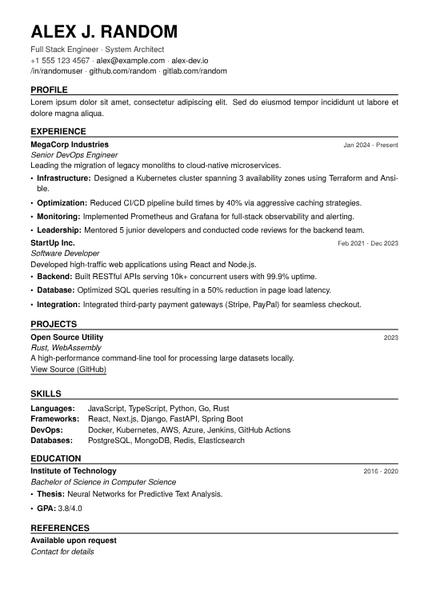

# Minimalist LaTeX Resume Template

A resume template based on Swiss design principles. It focuses on typography, readability, and ease of editing.



## Features

* **Clean design:** Minimalist layout using Helvetica/Arial for maximum readability.
* **ATS friendly:** A single column layout with standard fonts ensures applicant tracking systems parse it correctly.
* **Easy customization:** Centralized color definitions and custom commands for sections.
* **Print ready:** Professional margins and a black/dark gray color scheme for clear printing.

## How to Customize

Open `cv.tex` in your favorite editor (VS Code, TeXShop, Overleaf).

### 1. Changing personal info
Navigate to the `% --- HEADER ---` section in the document body.

```latex
\textbf{\MakeUppercase{your name}} \\[0.2cm]
{\color{darkgray}
title 1 $\cdot$ title 2 \\
+1 555 123 4567 $\cdot$ \href{mailto:email@example.com}{email@example.com}
}

```

### 2. Adding experience

Use the custom `\jobtitle` command followed by the description.

```latex
\jobtitle{company name}{date range}
\textit{job title} \\
description of your role...

```

### 3. Changing colors

Find the `% --- COLORS ---` section at the top of the file. You can use standard HTML hex codes.

```latex
\definecolor{mainblack}{HTML}{000000} % main text
\definecolor{darkgray}{HTML}{333333}  % subtitles & metadata
\definecolor{lightgray}{HTML}{555555} % lighter accents

```

### 4. Adjusting margins

If you need more space, adjust the geometry package settings:

```latex
\usepackage[left=1.5cm,right=1.5cm,top=1.25cm,bottom=1.25cm]{geometry}

```

## License

This project is open source and available under the MIT license.
Feel free to use it for your own CV!
